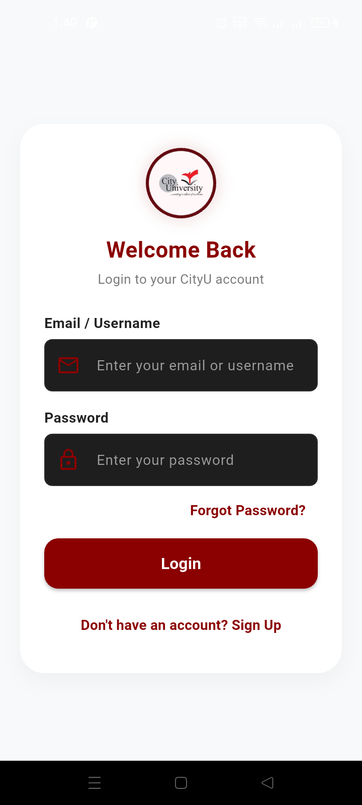
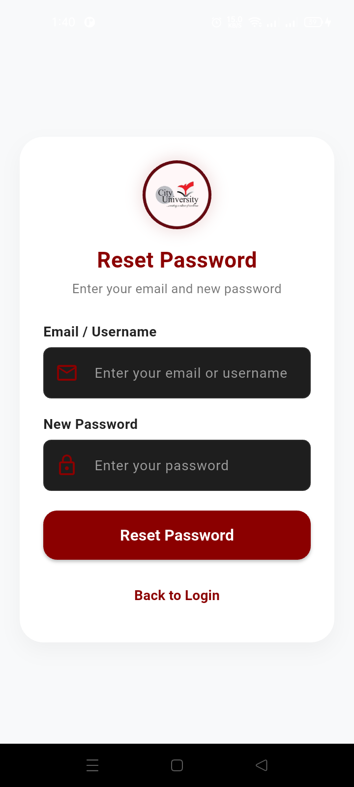
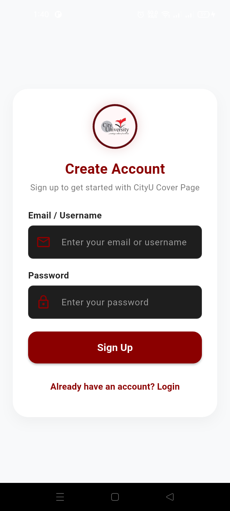
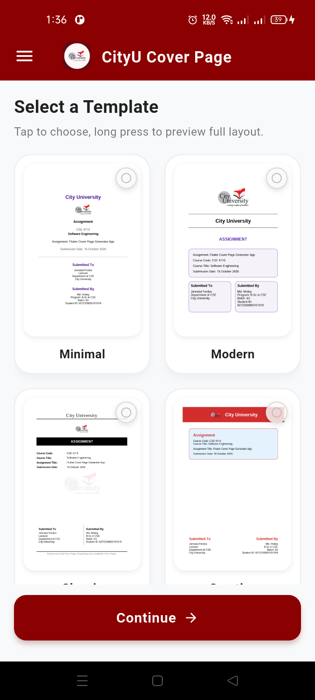
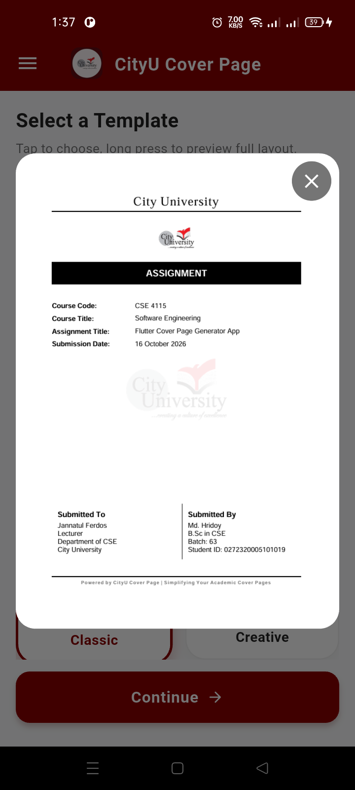
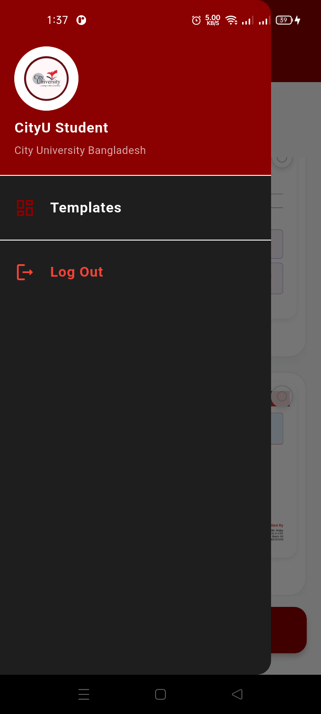
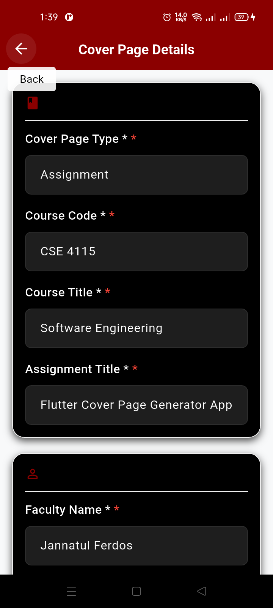
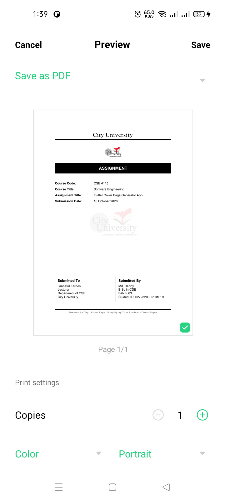

# City University, Bangladesh Cover Page App

A Flutter-based application designed to help City University students create academic cover pages for assignments, lab reports, and other university coursework.

## Overview

CityU Cover Page App aims to make academic cover page creation easier and more convenient for students. It provides a dedicated interface for preparing cover pages without having to design every page manually.

This project is based on Flutter and Dart.

**Developer Portfolio Website:** https://hridoycodes.vercel.app/

**App Download Link:** [Install Now](https://github.com/hridoycodes/Flutter-CityU-Cover-Page-App/releases/download/v1.0.0/app-debug.apk)

## Features

- **Assignment Cover Page Generator** — Generate cover pages for university assignments quickly and easily.
- **Lab Report Cover Page Generator** — Create professional cover pages for university lab reports.
- **4 Pre-Built Templates** — Choose from four ready-made cover page templates.
- **Fast Cover Page Generation** — Generate academic cover pages with minimal effort.
- **Modern UI Design** — Enjoy a clean, attractive, and user-friendly interface.
- **Student Information** — Add student details required for academic cover pages.
- **Course Information** — Include course title, course code, and other relevant academic details.
- **Registration Screen** — Access the app through a dedicated registration interface.
- **Splash Screen** — View an introductory screen when launching the app.
- **Navigation Drawer** — Navigate between app sections conveniently.
- **Easy Navigation** — Access the main features through a simple navigation flow.
- **Cover Page Preview** — Review the generated cover page before using it.
- **Reusable Templates** — Simplify the process of creating consistent academic cover pages.
- **Academic Productivity** — Reduce the time needed to prepare assignment and lab report cover pages.

*Note: The exact features depend on the current implementation. Keep only the features available in your version of the app.*

### Screenshots Demo

<table>
  <tr>
    <td></td>
    <td></td>
    <td></td>
  </tr>
  <tr>
    <td></td>
    <td></td>
    <td></td>
  </tr>
  <tr>
    <td></td>
    <td></td>
    <td></td>
  </tr>
</table>

## Tech Stack

- **Framework:** Flutter
- **Programming Language:** Dart
- **Development Tools:** Android Studio or Visual Studio Code
- **Version Control:** Git and GitHub

## Getting Started

Follow the instructions below to set up and run the project locally.

### Prerequisites

Before getting started, make sure you have installed:

- [Flutter SDK](https://docs.flutter.dev/get-started/install)
- Dart SDK
- [Android Studio](https://developer.android.com/studio) or [Visual Studio Code](https://code.visualstudio.com/)
- Java 17 Must Installed
- An Android emulator or a compatible physical device

### Installation

**1. Clone the repository**

```bash
git clone https://github.com/hridoycodes/Flutter-CityU-Cover-Page-App.git
```

**2. Navigate to the project directory**

```bash
cd Flutter-CityU-Cover-Page-App
```

**3. Install dependencies**

```bash
flutter pub get
```

**4. Check your Flutter environment**

```bash
flutter doctor
```

**5. Run the application**

Connect your device or start an emulator, then run:

```bash
flutter run
or
flutter run --android-skip-build-dependency-validation
```

**6. Generate Debug or Release Apk**

Connect your device or start an emulator, then run:

```bash
flutter build apk --debug --android-skip-build-dependency-validation
or
flutter build apk --release --android-skip-build-dependency-validation
```

## Project Structure

The project follows a Flutter application structure. The exact folders may vary depending on the current implementation.

```text
Flutter-CityU-Cover-Page-App/
├── android/
├── assets/
├── lib/
├── test/
├── pubspec.yaml
├── pubspec.lock
└── README.md
```

## Development

To check the project for potential issues, run:

```bash
flutter analyze
```

To execute the automated tests, if configured, run:

```bash
flutter test
```

## License

This Project is created only for educational purposes to help generating Assignment and Lab report cover pages quickly.

## Contributing

Suggestions, improvements, and bug reports are welcome.

1. Fork the repository.
2. Create a new branch for your changes.
3. Implement and test your changes.
4. Commit your changes with a descriptive message.
5. Submit a pull request describing your contribution.

## Developer: Md. Hridoy

**GitHub:** [hridoycodes](https://github.com/hridoycodes)
---

Developed with Flutter and Dart.
